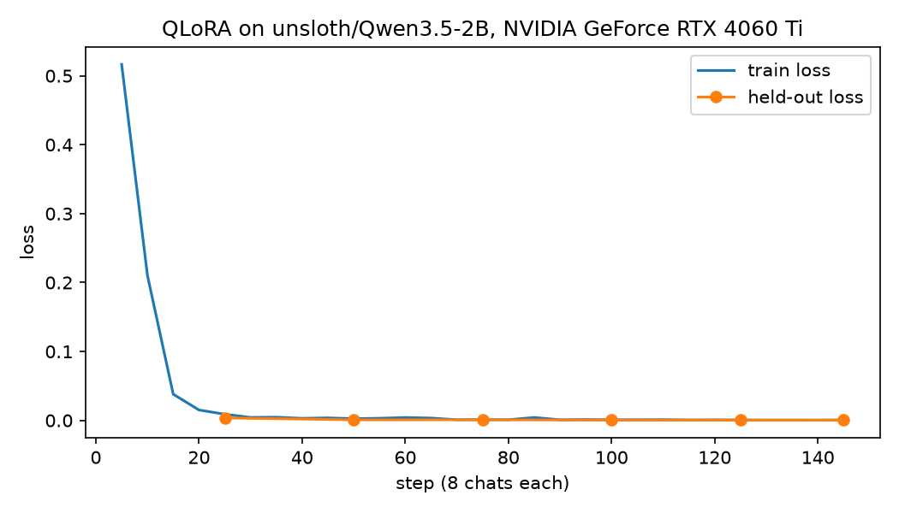

# Doc Extraction Fine-tune

Can a 2B model fine-tuned on a free GPU read Brazilian financial documents as well as Gemini? This repo fine-tunes
Qwen3.5-2B, a small vision-language model, to turn a boleto, a DANFE (the printout of an NF-e) or an informe de
rendimentos into typed JSON, and scores it with the eval harness of
[doc-extraction-copilot](https://github.com/Eric-Souza/doc-extraction-copilot), the app it replaces Gemini in.

**Status:** trained and scored. Fine-tuned, the 2B model reads 99.7% of the fields right, against Gemini's 99.9% and
its own 7.3% before, and every field it gets wrong is one the app flags for review.

- **Training:** QLoRA with [Unsloth](https://github.com/unslothai/unsloth), on a free Colab T4 or locally (the run below:
  an RTX 4060 Ti 8 GB in WSL, 20 minutes, 3.2 GB of GPU memory)
- **Tracking:** [Weights & Biases](https://wandb.ai): loss, eval loss and a table of held-out replies
- **Serving:** [Ollama](https://ollama.com) pulls the GGUF and its vision projector from the Hugging Face Hub
  ([eric-hugging-crazy/qwen3.5-2b-doc-extraction-br-GGUF](https://huggingface.co/eric-hugging-crazy/qwen3.5-2b-doc-extraction-br-GGUF)); [notebooks/serve_vllm.ipynb](notebooks/serve_vllm.ipynb)
  serves the merged model with [vLLM](https://docs.vllm.ai) on Colab, through a Cloudflare tunnel (not run yet)
- **Eval:** doc-extraction-copilot's 36 synthetic documents, with the same scoring and check-digit review as Gemini

## Results

On doc-extraction-copilot's 36 eval documents (768 fields), the Qwen models on Ollama (Q8_0) on an RTX 4060 Ti:

| Model | Classified | Field accuracy | Exact match | Silent errors |
|---|---|---|---|---|
| gemini-3.5-flash-lite (type detected) | 36/36 | 99.9% | 97.2% | 0 |
| **Qwen3.5-2B fine-tuned, type detected** | **36/36** | **99.7%** | **94.4%** | **0** |
| Qwen3.5-2B fine-tuned, type given | 36/36 | 99.7% | 94.4% | 0 |
| Qwen3.5-2B base, type detected | 12/36 | 7.3% | 0.0% | 672 |
| Qwen3.5-2B base, type given | 36/36 | 83.3% | 16.7% | 38 |
| Qwen3.5-2B base, schema in the prompt, type detected | 28/36 | 66.3% | 8.3% | 222 |
| Qwen3.5-2B base, schema in the prompt, type given | 36/36 | 89.5% | 16.7% | 38 |

A silent error is a wrong field the app's review didn't flag, the number that matters. The base model calls almost
every document a boleto, and with the type given it reads the digits well but puts values in the wrong fields and
formats. Ollama turns the JSON schema into a grammar, so the model sees the field names but not their descriptions;
`AI_SCHEMA_IN_PROMPT=1` also writes the schema into the system prompt, the best plain prompting does here. It still
calls 8 of the 12 informes "other", and leaves 38 wrong fields unflagged.

Fine-tuned, it classifies all 36 and gets 2 fields wrong, both on DANFEs: a digit of an NF-e number and of an access
key. The app's check-digit review flags both, so none would reach a user unnoticed, and it catches all 6 planted
inconsistencies. A document takes 4.2 seconds (median), as before. The model and Gemini still differ in one way the
table doesn't show: Gemini reads any layout, while the fine-tune has only seen these templates (see Caveats).

One epoch over the 1,156 training chats (145 steps of 8) took 20 minutes. The loss is near zero after about 25 steps,
and the 72 held-out chats come back as valid JSON with every field right:



[runs/](runs) has the loss history, the run summary and the held-out replies.

## How it works

1. **The training set** comes from doc-extraction-copilot's generator (`scripts/make-train-set.ts` there): 900
   fictional documents from other seeds than its eval set, and none with an identifier the eval set uses. Each is
   one chat with the app's exact system prompt and user prompt, the page images, and the known answer. A third also
   teach the classification call. PDFs are drawn page by page with the code the app uses before sending one to a
   local model, so training and inference see the same pixels. The last two documents of every 12 have a planted
   inconsistency, such as a printed amount that disagrees with the digit line, so the model learns to copy what is
   printed and leave the checking to code.
2. **The notebook** ([notebooks/finetune.ipynb](notebooks/finetune.ipynb)) trains a rank-16 LoRA on the language
   layers of the 4-bit base model. The vision layers stay frozen: the base model already reads the digits. The loss
   is on the reply only, images keep their full size, and the chat template has thinking off, as at inference. A
   cell checks that the rendered training chat starts with the exact prompt the server will send.
3. **The export** pushes the adapter, a merged 16-bit model and Q8_0 and Q4_K_M GGUFs to the Hub.
4. **The eval** runs in doc-extraction-copilot with `AI_PROVIDER=local`, which talks to any OpenAI-compatible
   server, draws PDFs as images and turns thinking off.

## Run it

You'll need free [Hugging Face](https://huggingface.co/settings/tokens) and [W&B](https://wandb.ai/authorize)
accounts, and doc-extraction-copilot cloned next to this repo.

```bash
cp .env.example .env                       # HF_USER, HF_TOKEN, WANDB_API_KEY

# The training set, rendered by doc-extraction-copilot, then uploaded as an HF dataset
cd ../doc-extraction-copilot && npx tsx scripts/make-train-set.ts --out ../doc-extraction-finetune/data
cd ../doc-extraction-finetune && pip install huggingface_hub && python scripts/upload_dataset.py <HF_USER>
```

Open [notebooks/finetune.ipynb](notebooks/finetune.ipynb) in Colab, choose a T4 runtime, add `HF_TOKEN` and
`WANDB_API_KEY` as secrets, set `HF_USER`, and run all. Then serve and score it:

```bash
ollama create doc-extraction-2b -f ollama/Modelfile     # the published model; your own after setting HF_USER in it
cd ../doc-extraction-copilot
AI_PROVIDER=local AI_MODEL=doc-extraction-2b npx tsx scripts/eval.ts --delay 0
```

`scripts/make_notebook.py` writes both notebooks from plain Python, so changes to it can be reviewed as code.

### Locally, on an 8 GB NVIDIA GPU

The same training runs in WSL (Ubuntu 24.04) with `scripts/train_local.py`, which reads `data/` instead of the Hub and
writes the loss to `runs/` instead of W&B. The model, the GGUFs and the Ollama model stay on the machine:

```bash
wsl -d Ubuntu-24.04 -- bash scripts/setup_wsl.sh       # once: the venv in ~/ft, with Unsloth
wsl -d Ubuntu-24.04 -- bash scripts/train_wsl.sh       # about 20 minutes; --max-steps 3 for a smoke test
wsl -d Ubuntu-24.04 -- bash scripts/llama_cpp_wsl.sh   # once: llama.cpp's GGUF converter
wsl -d Ubuntu-24.04 -- bash scripts/to_gguf_wsl.sh     # the Q8_0 model and the vision projector, in ollama/
ollama create doc-extraction-2b -f ollama/Modelfile.local
```

Then score it with the same eval command as above. To publish it under the notebook's names (the GGUF repo that
`ollama/Modelfile` pulls, and the LoRA adapter), set `HF_USER` and `HF_TOKEN` in `.env` and run
`wsl -d Ubuntu-24.04 -- bash -c '. ~/ft/.venv/bin/activate && python scripts/upload_model.py'`.

## Caveats

The training and eval documents come from the same generator and templates, from different seeds. That is the case
of a company fine-tuning on its own document layouts, not a test of documents the model has never seen the like
of. Every name, CPF and CNPJ is fictional.
